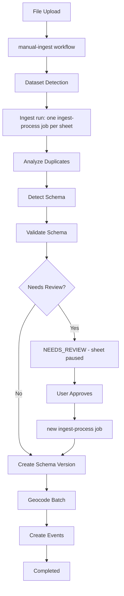

# Data Ingestion Pipeline

> **Terminology**: The ingestion pipeline is called "Import" in the UI and `ingest-*` in the codebase.

The TimeTiles data ingestion pipeline uses Payload CMS Workflows to transform uploaded files into structured events. Three source workflows detect the sheets of a file and dispatch one `ingest-process` job per sheet. Collection hooks, trigger services, scheduled handlers, and retry/reset endpoints queue workflows for their respective entry points.

## Quick Links

- **[Architecture & Design](./architecture)** - Design principles, core collections, and data flow
- **[Processing Stages](./stages)** - Detailed explanation of all 7 pipeline stages
- **[Configuration](./configuration)** - Dataset and system configuration options
- **[Troubleshooting & Recovery](./troubleshooting)** - Error model, common issues, debugging, and recovery

## Pipeline Overview

The pipeline uses 4 Payload Workflows: one per source type, plus `ingest-process`, which runs the tasks of one sheet:

## Four Workflows

| Workflow           | Trigger                                       | Purpose                               |
| ------------------ | --------------------------------------------- | ------------------------------------- |
| `manual-ingest`    | File upload (`ingest-files` afterChange hook) | Dataset detection, then dispatch      |
| `scheduled-ingest` | `lib/ingest/trigger-service.ts`               | URL fetch, detection, then dispatch   |
| `scraper-ingest`   | `schedule-manager` job                        | Scraper run, detection, then dispatch |
| `ingest-process`   | Dispatch, review approval, retry or reset     | Process, resume or retry one sheet    |

## Per-Sheet Task Pipeline

Each `ingest-process` job runs these tasks of its sheet sequentially:

1. **Analyze Duplicates** - Identify internal and external duplicates before processing
2. **Detect Schema** - Build progressive schema from non-duplicate data
3. **Validate Schema** - Compare detected schema with existing dataset schema
4. **Create Schema Version** - Persist new schema version
5. **Geocode Batch** - Enrich data with geographic coordinates
6. **Create Events** - Generate final event records with all enrichments

Every sheet runs as its own job with its own retries and `onFail`. If one sheet fails or needs review, the other sheets continue. The ingest run of the file collects the sheet outcomes and settles the file status and the source bookkeeping once (see [Architecture](/development/architecture/data-processing-pipeline/architecture#ingest-runs)).

## Key Features

**Workflow Orchestration**: Payload CMS Workflows define linear task pipelines with built-in retry and caching of completed tasks.

**Batch Processing**: Large files are processed in configurable batches to manage memory and respect API rate limits.

**Built-in Error Recovery**: Failed tasks are retried by Payload's workflow system. Completed tasks return cached output on retry, so work is never repeated.

**Schema Versioning**: Complete version history of all schema changes with audit trail.

**Multi-Sheet Support**: Every sheet of an Excel file runs as its own `ingest-process` job, so a failing sheet cannot block or retry the others.

## Core Principles

- **Single Source of Truth**: Raw data files stay on disk; only processing state and results are stored in the database
- **File-Based Processing**: Data flows from file, to memory, to database, avoiding large data storage during processing
- **Metadata Tracking**: Processing state, schemas, duplicate maps, and geocoding results are persisted for resumable operations
- **Concurrency Control**: Per-resource concurrency keys prevent duplicate processing of the same file or scheduled import

## Next Steps

New to the pipeline? Start with [Architecture & Design](./architecture) to understand the system's core principles.

Working on a specific stage? See [Processing Stages](./stages) for detailed documentation of each stage.

Need to configure behavior? Check [Configuration](./configuration) for dataset and system options.

Having issues? Visit [Troubleshooting](./troubleshooting) for common problems and solutions.

Looking for the user-facing overview? See the [Data Import guide](/guide/data-import).
